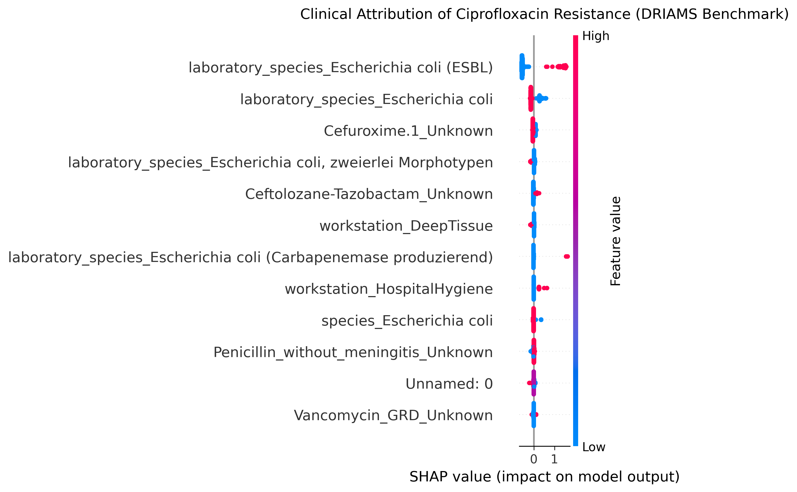

# explainable-amr-prediction
# Explainable Machine Learning for Antimicrobial Resistance (AMR) Prediction

An end-to-end clinical machine learning framework to predict Ciprofloxacin non-susceptibility in *Escherichia coli* isolates using laboratory phenotype metadata from the multi-center DRIAMS benchmark dataset.

## Clinical Motivation
Antimicrobial resistance (AMR), particularly fluoroquinolone resistance in Gram-negative pathogens, poses a major challenge to empirical pediatric antimicrobial therapy. This pipeline leverages clinical and microbiological phenotypes to predict susceptibility patterns, utilizing Explainable AI (SHAP) to interpret biological risk drivers.

## Dataset Description & Source

* **Dataset Name:** DRIAMS (Database of Resistance Information on Antimicrobials and MALDI-TOF Mass Spectra)
* **Sub-cohort Utilized:** `DRIAMS-A` (Clinical Diagnostic Laboratory, University Hospital Basel, Switzerland)
* **Source Platform:** [Kaggle Dataset (`drscarlat/driams`)](https://www.kaggle.com/datasets/drscarlat/driams) / [Dryad Digital Repository (DOI: 10.5061/dryad.bzkh1899q)](https://datadryad.org/dataset/doi:10.5061/dryad.bzkh1899q)
* **Primary Reference:** Weis, C., Cuénod, A., Rieck, B., et al. *Direct antimicrobial resistance prediction from clinical MALDI-TOF mass spectra using machine learning.* **Nature Medicine** 28, 164–174 (2022). https://doi.org/10.1038/s41591-021-01619-9

### Data Structure & Cohort Extraction
The original DRIAMS repository contains over 300,000 mass spectra and microbiological profiles across 804 pathogens tested against 52 antimicrobials. For this predictive benchmark:
* **Target Organism:** *Escherichia coli* (`species` containing `coli`).
* **Target Antimicrobial:** **Ciprofloxacin** (Fluoroquinolone class; binary classification where `Resistant (R)` and `Intermediate (I)` are labeled as `1`, and `Susceptible (S)` is labeled as `0`).
* **Analyzed Cohort:** Consolidated longitudinal metadata from `DRIAMS-A/id/` (2015–2018), yielding **10,204 validated *E. coli* isolate records**.
* **Target Balance:** 70.52% Susceptible (`0`), 29.48% Non-Susceptible (`1`).

## Pipeline Architecture & Methodological Rigor
- **Cohort Aggregation:** Ingested and combined multi-year clinical metadata tables (2015–2018) from DRIAMS-A, compiling a cohort of **10,204 validated *E. coli* isolates**.
- **Leakage Prevention:** Purged 41 co-tested antibiotic outcome columns and sample tracking IDs to prevent artificial shortcut learning.
- **Class Imbalance Calibration:** Utilized cost-sensitive `scale_pos_weight` within an XGBoost Classifier to handle the ~30% positive resistance prevalence.
- **Explainability Layer:** Computed TreeSHAP values to uncover non-linear clinical and phenotypic feature attributions.

## Performance
- **ROC-AUC:** 0.7974
- **PR-AUC:** 0.6618
- **Overall Accuracy:** 0.83 (Macro F1: 0.78)
- **Susceptible (S):** Precision: 0.85 | Recall: 0.93 | F1: 0.88
- **Resistant (R):** Precision: 0.77 | Recall: 0.59 | F1: 0.67

## Interpretability & Phenotypic Insights

- **ESBL Status:** *E. coli* isolates identified as Extended-Spectrum Beta-Lactamase producers exhibited the strongest positive attribution toward Ciprofloxacin resistance, confirming established multi-drug resistance co-selection dynamics.
- **Microbiological Markers:** Isolates with carbapenemase production and specific hospital-hygiene workstation origins demonstrated elevated resistance odds.
